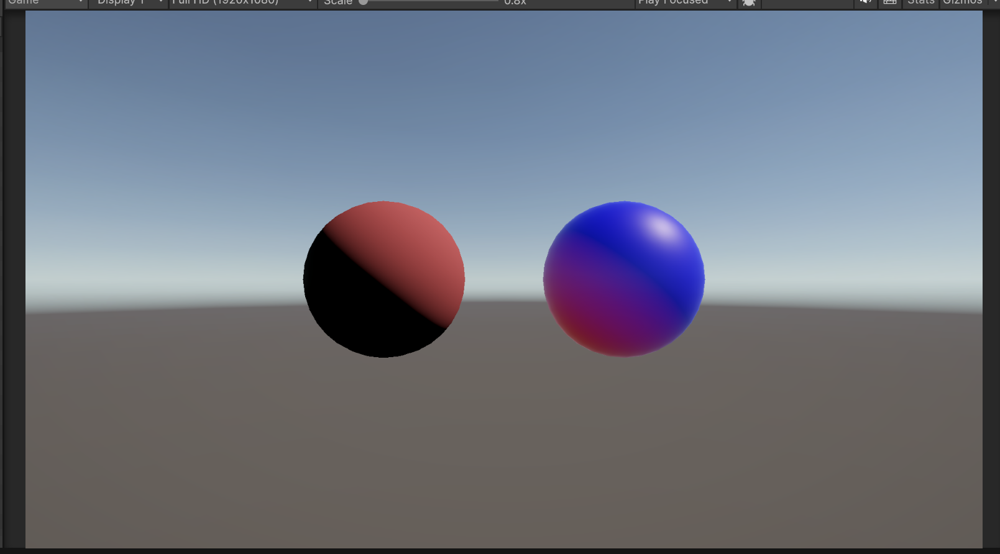

# はじめに
プログラムワークショップⅣの4つ目の管理用です

# 結果画像

- 工夫した点：ランバート拡散反射を利用し、光の当たり方に応じて青から赤へ色が変化するようにしました

# 進め方

- 本リポジトリをforkしてください。
- fork先のリポジトリを更新してください
- Unityのプロジェクトをsrc内で進めて下さい。
- 結果を画面キャプチャして、画像としてリポジトリに追加して、上記のリンクから見れるようにしてください。
- 完成したら本リポジトリのmainブランチにpull requestを投げてください

